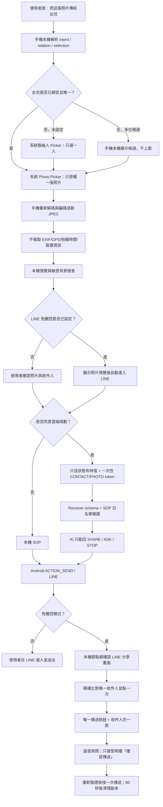
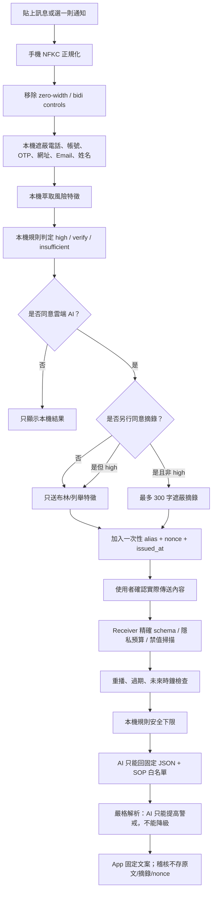

# PrivAgent：情境一、情境二隱私、功能與 UI 交接文件

> 更新日期：2026-11-02（Asia/Taipei）
>
> 對應分支：`feature/share-photo-line-chain`
>
> 功能基準提交：`94d2e56`（正式亮色雙情境 UI）
>
> 前置提交：`76ae711`（照片到 LINE 完整鏈）、`ee9263b`（fail-closed LINE 免觸控）
>
> 上游基準：`origin/main` 的 `a765896`
>
> 文件目的：讓下一位開發者可以區分「已完成」「部分完成」「規劃中」，並能沿著既有架構繼續實作、測試及製作競賽展示。

---

## 0. 一頁摘要

本專案目前處理兩個核心情境：

1. **情境一：把圖片發送給女兒**（`SHARE_PHOTO`）
   - 核心隱私目標：只存取使用者選中的一張照片；聯絡人身分只在手機解析；分享前移除 EXIF/GPS；雲端 AI 不取得照片、姓名、聯絡方式或完整語音內容。
   - 現況：基本分享流程、單張／最新照片、本機關係綁定、獨立 LINE 顯示名稱、照片重新編碼、GPS/EXIF 清除、確認畫面、雲端代號封包與 SOP 白名單已完成。
   - 選用免觸控：已加入只監看 LINE package 的獨立 AccessibilityService，以固定狀態機做「分享畫面指紋 → 唯一精確收件人 → 唯一傳送按鈕 → 明確語音確認 → 各點一次」。任何不確定皆停止。
   - 主要缺口：尚未自動辨識照片像素中的人臉、證件、地址、螢幕文字、QR code 等「視覺型個資」；真實 LINE 版本仍需逐版校準畫面節點；LINE 無障礙自動化有 Google Play 政策風險。

2. **情境二：收到訊息，判斷是不是詐騙**（`CHECK_MESSAGE`）
   - 核心隱私目標：原始訊息預設不離開手機；手機先去識別化並萃取少量風險特徵；高風險訊息禁止送摘錄；雲端 AI 只能從固定 SOP 中選擇，而且不得降低手機本機規則的風險判定。
   - 現況：情境二的隱私邊界、可執行隱私預算、重播防護、Receiver 二次檢查、AI 輸出白名單、稽核最小化、紅隊變形測試與 Android 實機等價測試均已完成 MVP。
   - 目前合成資料評測：6,144 則訊息中，封包識別值洩漏、原文直接暴露、高風險漏判、安全訊息誤判為高風險、140 組變形攻擊失敗數皆為 0。但這是**有限合成模板的一致性結果，不等於真實世界詐騙辨識率 100%**。

本專案最值得強調的競賽亮點不是「用了很多 PET 名詞」，而是採取以下做法：

> **先研究紅隊曾成功利用的推回、oracle、實作錯誤與隱私—效用落差，再把防守直接放入資料流、封包契約、輸出限制與自動化評測。**

目前產品首頁只顯示這兩個情境。舊的手機救援與原始研究蒐集模組仍留在 repository 供研究測試，但 `MainActivity` 不再提供啟動入口，且開啟新版首頁時會停止舊研究 session／realtime service。

### 0.1 目前可交付成品

| 成品 | 位置／版本 | 狀態 |
|---|---|---:|
| Android 原始碼 | `app/`，功能基準 `94d2e56` | ✅ |
| 情境一 LINE 完整鏈 | `76ae711` + `ee9263b` | ✅ MVP |
| 正式亮色雙情境 UI | `94d2e56` | ✅ |
| Debug APK | `D:\PriveMVP\PrivAgent-two-scenarios-light-ui-v0.4-debug.apk` | ✅，v2 簽章 |
| APK SHA-256 | `1EE49B62455BF86F6CB9591BFD6297EB6BD0CAF40514B241479B7DDB5CA4AA33` | ✅ |
| JVM 測試 | 67／67 | ✅ |
| Android instrumentation | 8／8（Pixel 6 Pro AVD / API 34） | ✅ |
| Android Lint | 0 error；37 個既有 warning | ✅ 可建置 |

---

## 1. 狀態標示

| 標示 | 意義 |
|---|---|
| ✅ 已完成 | 程式中已有可執行功能，並至少有自動化測試或實際流程驗證 |
| 🟡 部分完成 | 已有 MVP，但仍有明確的隱私或產品缺口 |
| ⬜ 規劃中 | 建議的後續實作，尚不可在展示時宣稱完成 |

交接與簡報中務必使用這套區分，避免把目標架構說成現有成果。

---

## 2. 競賽紅隊經驗與本專案的防守亮點

### 2.1 可公開確認的競賽背景

[NIST 的 U.S.–U.K. PETs Prize Challenge](https://www.nist.gov/itl/applied-cybersecurity/privacy-engineering/collaboration-space/challenges/us-uk-pets-prize) 以紅隊／藍隊形式進行：藍隊建立隱私保護聯邦學習方案；依 [DrivenData 第三階段說明](https://www.drivendata.org/competitions/139/nist-federated-learning-3-red-teams/page/633/)，紅隊可取得概念文件、容器映像、原始碼、訓練模型、client／aggregator 通訊、預測及評估資料，並透過白箱與黑箱方式測試隱私主張。競賽本身主要是聯邦學習，但其紅隊經驗可轉用到本專案的 AI Agent 資料流。

公開資料可確認的成功攻擊方向如下：

1. **從低維特徵或輸出推回敏感狀態**  
   第一名紅隊 ETH SRI 針對銀行持有的敏感布林 flag 進行推回；[NIST 公開摘要](https://www.nist.gov/itl/applied-cybersecurity/privacy-engineering/collaboration-space/challenges/us-uk-pets-prize)表示其攻擊具有高度泛化性，且達到近乎完美的準確率。這說明「沒有傳原始資料，只傳一個布林值」仍不代表沒有隱私風險。

2. **攻擊 PET 的錯誤實作，而非攻破理論本身**  
   第二名紅隊 Entmoot 特別指出：HE、DP、SMPC 的理論很強，但宣稱使用和正確實作之間有很大差距；其方法是追蹤完整原始碼邏輯，尋找細小的整合或參數錯誤。此方向同樣記錄於 [NIST 的紅隊成果摘要](https://www.nist.gov/itl/applied-cybersecurity/privacy-engineering/collaboration-space/challenges/us-uk-pets-prize)。

3. **利用端點、錯誤訊息、行為差異與 oracle 回推明文**  
   第三名紅隊 Blackbird Labs 從系統提供的 endpoints 出發，利用實作弱點及資料中的 signals/oracles，一步步回推 plaintext；也會比較設計文件與實際程式，尋找設計者沒考慮到的 exploit path。[NIST 公開頁面](https://www.nist.gov/itl/applied-cybersecurity/privacy-engineering/collaboration-space/challenges/us-uk-pets-prize)列出了這項方法與成果。

4. **隱私很強但效用不足，也是一種失敗**  
   ETH SRI 在疫情軌亦比較了隱私與效用；[競賽成果摘要](https://blog.drivendata.org/blog/federated-learning-pets-prize-winners-phases-2-3)指出部分方案存在效用不足。這對本專案很重要：如果雲端 AI 沒有帶來可量化的改善，就不應為了「有 AI」而傳送更多資料。

5. **模型更新與模型本身都可能洩漏訓練資料**  
   [NIST 對聯邦學習隱私攻擊的整理](https://www.nist.gov/blogs/cybersecurity-insights/privacy-attacks-federated-learning)包含：從 model updates／gradients 重建輸入，以及從訓練後模型進行 membership inference、model inversion 或資料重建。

### 2.2 本專案如何把紅隊經驗轉成設計原則

| 紅隊成功路徑／官方攻擊面 | 對本專案的意義 | 已採取的防守 | 後續仍應補強 |
|---|---|---|---|
| 敏感布林 flag 可被推回 | `asks_transfer=true`、`impersonation=family` 本身仍會透露訊息語意 | 只有明確同意才送；無穩定身分；每次新 alias/nonce；高風險不送摘錄 | 增加「嚴格模式」，只送 `risk_band` 或 SOP；逐欄證明 AI 是否真的需要該特徵 |
| PET 實作錯誤 | 規格正確不代表 Android、Python、proxy 實作一致 | 精確 schema、跨語言 golden tests、Android instrumentation、可執行 policy hash | property-based fuzzing、依賴鎖定、正式 code review、負向整合測試 |
| endpoint／oracle 回推明文 | 不同錯誤、延遲、封包大小可能透露內部判斷 | token、rate limit、固定回應 schema、禁止 AI 自由文字、Receiver 二次掃描 | 對外統一錯誤、內外日誌分離、固定大小封包或關閉摘錄、request signing |
| 原始碼白箱檢查 | 不可依賴「攻擊者不知道封包格式」 | 按公開規格仍不包含原文、姓名、電話、帳號；安全依賴資料最小化與白名單 | 建立 threat-model 測試清單，定期由未參與開發者重做紅隊 |
| 隱私—效用落差 | 雲端若沒有增益，就不值得揭露資料 | 本機規則先決；AI 只能提高謹慎度、不能降低；失敗自動回退本機 | 建立 local-only 與 local+AI 的真實資料 A/B 評測，量化 AI 增益 |
| gradient/model reconstruction | 未來若新增訓練，更新值可能洩漏個資 | 現階段沒有中間模型訓練，因此不產生 gradients／model updates | 未來真的訓練時才導入 DP-SGD、secure aggregation、HE/SMPC 並做 membership/reconstruction attack |

### 2.3 對外說法的精確界線

建議簡報使用：

> 我們參考 PETs Prize 公開紅隊的成功路徑：敏感旗標推回、實作錯誤、endpoint/oracle 回推與隱私—效用落差，將其轉成資料最小化、無穩定識別、精確封包契約、本機安全下限、AI 輸出白名單及自動紅隊測試。

不應宣稱：

- 本專案重現了競賽所有未公開攻擊報告。
- 使用 HE／DP／SMPC 就代表系統一定安全。
- 6,144 筆合成資料 0 失敗代表真實世界 100% 準確。
- 只傳布林特徵就等於完全匿名。

---

## 3. 共用威脅模型與資料邊界

### 3.1 保護對象

- 使用者原始訊息、通知內容與其聯絡人名稱。
- 照片像素、EXIF/GPS、拍攝時間、裝置型號與相簿範圍。
- 使用者與「女兒／兒子／照顧者」等關係的真實姓名對應。
- 任務之間的關聯性，例如同一人多次檢查哪些訊息、分享哪些照片。
- AI 產生的決策與稽核紀錄，避免它們成為新的隱私資料庫。

### 3.2 假設的攻擊者

- 惡意或遭入侵的雲端 AI／proxy／Receiver。
- 能觀察 API endpoint、封包大小、錯誤碼、時序與多次請求的外部攻擊者。
- 取得原始碼與封包規格的白箱紅隊。
- 惡意訊息寄件者，刻意加入 prompt injection、Unicode、零寬字元、emoji 或標點以繞過偵測。
- 惡意分享 App、錯誤收件人選擇、過度權限與遺留暫存檔。
- 取得手機備份、SharedPreferences 或 cache 的本機攻擊者。

### 3.3 共用防守原則

1. **Local first**：先在手機完成可完成的工作。
2. **Data minimization**：雲端只取得完成當次決策真正需要的欄位。
3. **No stable identity**：跨任務不得重用使用者、聯絡人、照片或訊息識別碼。
4. **Explicit consent**：雲端、摘錄、分享都要分開同意。
5. **Fail closed / fail local**：AI 或網路錯誤時不自動擴大資料揭露，也不自動執行危險動作。
6. **Constrained AI**：模型只能在固定 SOP 白名單中選擇；固定文案由 App 顯示。
7. **Defense in depth**：手機去識別一次，Receiver 再檢查一次；不能只相信客戶端。
8. **Red-team as regression**：曾成功的繞過方式要變成可重跑測試，不只寫在報告裡。

---

## 4. 情境一：把圖片發送給女兒（SHARE_PHOTO）

### 4.1 預期使用流程



### 4.2 現有實作盤點

| 功能／隱私控制 | 狀態 | 現有實作 |
|---|---:|---|
| 本機意圖解析 | ✅ | `CoreTasks.interpret()` 解析 `SHARE_PHOTO`、relation、selection |
| 單一照片最小存取 | ✅ | Android 13+ 使用 `MediaStore.ACTION_PICK_IMAGES`；舊版用 `ACTION_GET_CONTENT`，不必掃描整本相簿 |
| 單一聯絡人最小存取 | ✅ | 使用系統 contact picker，只取得使用者選中的 DISPLAY_NAME，不要求讀取整本通訊錄 |
| 關係綁定留在手機 | ✅ | `RelationBindings` 儲存 relation → name；不送到雲端 |
| 多位同關係候選本機消歧 | ✅ | 多位「女兒」候選只在手機顯示，雲端不會看到名字 |
| EXIF/GPS 清除 | ✅ | `PhotoSanitizer` 解碼原圖後產生全新 JPEG，只保留像素；不複製 EXIF |
| 圖片尺寸與解碼資源限制 | ✅ | 最長邊降至 2048，降低超大圖片造成記憶體風險 |
| 分享前預覽與雙重確認 | ✅ | 顯示縮圖、關係與姓名；使用者確認後才進入規劃與 share intent |
| 雲端不取得照片與姓名 | ✅ | cloud packet 只有狀態、selection、一次性 `CONTACT_`／`PHOTO_` token |
| AI SOP 白名單 | ✅ | 只允許 `SHARE_PHOTO_GUIDED`、`ASK_USER`、`STOP` |
| AI 不得比本機更冒進 | ✅ | `AssistClient.plan()` 以 caution order 保留較謹慎結果 |
| 取消／新任務清除暫存 | ✅ | `newTask()`、取消、App 初始化會刪除 `cache/shared` 暫存照片 |
| LINE 顯示名稱獨立綁定 | ✅ | Android 聯絡人名稱與 LINE 名稱分開儲存；第一次使用時本機確認，不送到 AI |
| LINE package 範圍限制 | ✅ | `line_share_accessibility_config.xml` 只接收 `jp.naver.line.android` 事件 |
| 一次性自動化 capability | ✅ | `LineAutomationSession` 只存在記憶體、TTL 120 秒、每階段只允許前進一次；完成、取消或逾時會清零工作階段 HMAC 金鑰與摘要 |
| 防一般聊天室誤觸 | ✅ | 必須先辨識「分享對象／選擇傳送對象／Share with」等固定畫面指紋；普通聊天畫面即使也有姓名與 Send 也不操作 |
| 姓名最小留存比對 | ✅ | 工作階段不保存原始 LINE 姓名或未加鹽 hash；每次用隨機 256-bit key 做 HMAC-SHA256，比對可見節點後只保留摘要 |
| 找不到時的有限滑動 | ✅ | 只對可見且可向前捲動的清單執行 `ACTION_SCROLL_FORWARD`；頁面 HMAC 不變、24 頁上限或清單無法捲動即停止 |
| 防同名／模糊選人 | ✅ | 只接受正規化後 HMAC 完全相同且畫面唯一的收件人；0 個會有限滑動，多個結果立即停止 |
| 送出前語音確認 | ✅ | 語音只接受 allowlist 明確句型；「好」等模糊回答視為 unknown 並停止 |
| 自動化不由 AI 決定 | ✅ | AI 不能產生座標或操作；固定本機狀態機最多點一次收件人與一次送出 |
| 傳送後暫存清理 | ✅ MVP | LINE 接受送出操作後保留 60 秒 I/O 寬限，再清除清理後 JPEG；新任務與冷啟動也會清理 |
| 視覺型個資偵測 | 🟡 | 目前只有提醒使用者檢查背景；沒有 OCR、人臉、證件或 QR 偵測 |
| 自動模糊／裁切 | ⬜ | 尚未實作 |
| 關係綁定加密 | 🟡 | 只存在手機，但目前為一般 SharedPreferences；應改成 Android Keystore 保護 |
| 真實 LINE 版本相容性 | 🟡 | 邏輯與 fail-closed 測試已完成，但模擬器沒有 LINE；需用實機校準每版分享頁標籤／resource id |
| Google Play Accessibility 政策 | 🟡 | 適合競賽／側載展示；上架前須做 Accessibility API 聲明、醒目揭露與政策資格審查 |
| 完全本機語音辨識 | 🟡 | 設定 `EXTRA_PREFER_OFFLINE=true`，但是否真的不上雲仍受手機語音服務影響 |

主要程式位置：

- [`AssistantPanel.kt`](app/src/main/java/com/example/privagentcollector/AssistantPanel.kt)：分享流程、選人、選照片、確認與 share intent。
- [`CoreSupport.kt`](app/src/main/java/com/example/privagentcollector/CoreSupport.kt)：關係／LINE 名稱綁定、照片重新編碼與 EXIF/GPS 處理。
- [`LineAutomation.kt`](app/src/main/java/com/example/privagentcollector/LineAutomation.kt)：一次性 session、TTL 與不可逆狀態轉移。
- [`LineAutomationRules.kt`](app/src/main/java/com/example/privagentcollector/LineAutomationRules.kt)：收件人、分享畫面、Send 與語音 allowlist 規則。
- [`LineShareAccessibilityService.kt`](app/src/main/java/com/example/privagentcollector/LineShareAccessibilityService.kt)：LINE 節點樹偵測與 fail-closed 點擊。
- [`LineVoiceConfirmActivity.kt`](app/src/main/java/com/example/privagentcollector/LineVoiceConfirmActivity.kt)：最後語音確認。
- [`CoreTasks.kt`](app/src/main/java/com/example/privagentcollector/CoreTasks.kt)：分享封包、token 與 SOP。
- [`receiver/core_tasks.py`](receiver/core_tasks.py)：Receiver 契約與情境一規則參考實作。

### 4.3 資料最小化：每一層實際能看到什麼

| 層級 | 可看到 | 不應看到 |
|---|---|---|
| 手機 App | 使用者選中的照片、選中的聯絡人名稱、關係、原始 EXIF | 其他相簿照片、其他未選聯絡人 |
| 暫存目錄 | 新 JPEG 像素、縮圖 | 原始 EXIF、GPS、原始檔案名稱 |
| Receiver | `recipient_ready`、`photo_ready`、`location_removed`、selection、一次性 token | 圖片 bytes、姓名、電話、LINE ID、原始 URI |
| 雲端 AI | 與 Receiver 相同的少量狀態 | 照片、姓名、原始語音、聯絡人清單 |
| 分享 App | 清除 metadata 後的新 JPEG | 原始 EXIF/GPS；但仍能看到照片像素中的內容 |
| LINE 免觸控服務 | 比對當下短暫讀取 LINE 可見節點文字、content description、view id、可點擊／選取狀態 | 不截圖、不做 OCR、不保存／上傳原文、不處理其他 package；姓名與頁面只留下當次隨機金鑰的 HMAC，任務結束即清零 |
| 稽核 | 任務 alias、SOP、reason code | 圖片、姓名、token → 真實對象映射 |

### 4.4 雲端封包範例

雲端看到的是類似下列資料，而不是照片或「王小美」：

```json
{
  "schema": "privagent.planner_packet.v1",
  "task_id_alias": "TASK_QWERTYUI",
  "intent": "SHARE_PHOTO",
  "facts": {
    "recipient_ready": true,
    "photo_ready": true,
    "share_app_ready": true,
    "location_removed": true,
    "private_background_review": false,
    "selection": "selected"
  },
  "recipient_token": "CONTACT_ASDFGHJK",
  "photo_token": "PHOTO_ZXCVBNMQ",
  "confirmation": "approved",
  "allowed_sops": ["SHARE_PHOTO_GUIDED", "ASK_USER", "STOP"]
}
```

`CONTACT_*` 和 `PHOTO_*` 只是一個任務內的隨機代號，不可建立跨任務人物／照片歷史。

### 4.5 建議的後續具體實作

#### P0：交付前必要補強

1. **補照片隱私掃描器 `PhotoPrivacyScanner`**
   - 所有分析留在手機。
   - OCR：找電話、地址、身分證格式、帳號、醫療文字、車牌文字。
   - QR／Barcode：提示可能含登入或付款連結。
   - 人臉數量：只回傳 `face_count_band=0/1/many`，不要保存 face embedding。
   - 文件／螢幕分類：用簡單 on-device classifier 或版面規則標記 `document_like`、`screen_like`。
   - 結果只用於本機預覽；除非能證明 AI 必要，不送雲端。

2. **把 `private_background_review` 接到真實狀態**
   - 目前程式送 `false`，但 UI 只做文字提醒。
   - 建議改成 `clear / needs_review / blocked` 三態，而不是單一布林值，並同步更新 Android、Receiver schema、測試與 policy version。

3. **敏感區域處理**
   - 在預覽畫面框出 OCR／臉／QR 區域。
   - 提供「模糊」「裁切」「仍要分享」「取消」。
   - 編輯後再次重新編碼，避免編輯軟體重新帶入 metadata。

4. **關係綁定加密**
   - 使用 Android Keystore 產生不可匯出的金鑰，以 AES-GCM 加密 relation → name。
   - `allowBackup=false` 已存在，仍應確認自動備份及裝置轉移不會帶走明文。

5. **暫存與 URI grant 完整生命週期**
   - 現況已有新任務／冷啟動清除，以及自動送出後 60 秒刪除。
   - 後續仍應補「手動 LINE 分享完成／取消」的可靠 callback 或最長 TTL，並驗證 process death 後的過期檔清除。
   - 目前只使用 Intent 的暫時 URI grant，沒有建立長期 `grantUriPermission`；仍需做 OEM 相容性測試。

#### P1：紅隊導向強化

1. **惡意圖片測試**：超大尺寸、截斷 JPEG、偽造 EXIF、旋轉、ICC profile、decompression bomb。
2. **分享 App 測試**：錯誤 package、未安裝 LINE、惡意 share target、URI 權限逾時。
3. **收件人混淆測試**：兩位同名女兒、聯絡人改名、刪除聯絡人、舊 binding、Unicode 同形字。
4. **語音隱私測試**：裝置不支援離線 ASR 時明確提示，允許改打字；不要默默改用雲端語音。
5. **oracle 測試**：不同照片敏感程度不應在公開 API 產生可大量探測的細緻錯誤訊息。

#### P2：產品化

- 正式 release signing、Play Integrity／供應鏈檢查。
- 清楚的相機／相簿／聯絡人權限說明與撤回入口。
- 無障礙的大字體預覽、語音重述與「最後一次確認」。
- 若要 Google Play 正式上架，優先評估 LINE 官方授權整合；若保留 Accessibility，必須維持 package scope、靜態狀態機、醒目揭露、語音確認與 fail-closed，並完成政策審查。不可改成 AI 自主規劃任意點擊。

### 4.6 情境一驗收條件

| 指標 | MVP 現況 | 建議交付門檻 |
|---|---:|---:|
| 雲端收到照片 bytes | 0 | 必須維持 0 |
| 雲端收到真實姓名／電話 | 0 | 必須維持 0 |
| 原始 EXIF tag 被帶到輸出 | 設計上 0，需建立批次證據 | 0／全部測試照片 |
| 未授權相簿照片讀取 | Photo Picker 設計上 0 | 0 |
| 不唯一收件人直接分享 | 已阻擋 | 0 |
| 視覺型個資自動攔截 | 尚未完成 | 高風險測試集 recall 需另外訂門檻 |
| 自動送出後暫存逾期殘留 | 60 秒清理已實作，尚未做 process-death 批次證據 | TTL 後 0 |
| 非 LINE／普通聊天室誤點 | 固定 package + 分享畫面指紋阻擋 | 0 |
| 同名或非唯一收件人自動送出 | fail closed | 0 |
| 未明確說「確認傳送」仍送出 | allowlist + unknown/cancel 中止 | 0 |

目前 `core_eval` 的合成工作流中共有 576 個 `SHARE_PHOTO` 任務：19 個符合完整授權後產生 cloud packet，320 個要求補問、24 個留在本機、213 個停止。19 個情境一 cloud packet 中未發現直接識別值、不必要欄位、未授權傳送、token 重用或 schema 拒絕。這是政策一致性測試，不是照片視覺內容隱私測試。

---

## 5. 情境二：判斷訊息是不是詐騙（CHECK_MESSAGE）

### 5.1 實際資料流



### 5.2 現有實作盤點

| 功能／隱私控制 | 狀態 | 現有實作 |
|---|---:|---|
| 原文預設留在手機 | ✅ | default packet 不含 raw message |
| 本機去識別化 | ✅ | 電話、Email、URL、ID、OTP、帳號、數字、已知聯絡人名稱 |
| 本機連結網域分級 `link_kind` | ✅ | 2026-11-02 起（packet v3）。網址只在手機分級為 `known_official / unknown / shortener / suspicious`，封包只送枚舉；官方白名單不再因「連結＋催促」誤判高風險，仿冒拼寫、IP、punycode、`@` 夾帶、高風險 TLD 直接高風險。清單示範用，見 `docs/CHECK_MESSAGE_PRIVACY.md` |
| Unicode／零寬／Bidi 正規化 | ✅ | NFKC、移除 format controls、separator control 正規化 |
| 空白／標點／emoji 繞過 | ✅ | 建立 detection compact view，偵測 `轉-帳`、`匯💸款`、`驗·證·碼` 等 |
| 否定語意基本處理 | ✅ | 「請勿提供驗證碼」不直接當成索取；後續真正要求仍可抓到 |
| 本機風險安全下限 | ✅ | AI 只能提高警戒，不能把本機 high 降成 verify |
| 摘錄預設關閉 | ✅ | `redacted_excerpt=null` |
| 摘錄獨立同意 | ✅ | 使用者另勾選；傳前顯示完整 packet 說明 |
| 高風險禁止摘錄 | ✅ | local risk=high 時，即使同意也強制 `null` |
| 摘錄長度與保留限制 | ✅ | 最多 300 code points；Receiver audit 不保存 |
| 精確可執行隱私預算 | ✅ | `check_message_privacy_policy.json` 定義欄位、enum、保留與禁值 |
| Receiver 二次禁值掃描 | ✅ | 不信任手機；再次找電話、帳號、URL、OTP、姓名與持久 ID |
| 防重播與新鮮度 | ✅ | 5 分鐘 max age、1 分鐘 future skew、一次性 nonce cache |
| Schema smuggling 防護 | ✅ | top-level 與 facts 欄位必須精確相等，多餘欄位拒絕 |
| AI prompt injection 降級防護 | ✅ | 訊息不能覆蓋 local floor；AI 回應必須為單一 JSON |
| AI output injection 防護 | ✅ | 拒絕多 JSON、前後文字、alias 不符、SOP 不在白名單 |
| 稽核最小化 | ✅ | 不記原文／摘錄／nonce；只記政策版本、alias 與結果 |
| 自動通知檢查 | ✅ | 一律只送 features，不送 excerpt；僅 high 跳提醒 |
| 公開端點防護 | ✅ | token、assist-only route、每分鐘 rate limit、HTTPS tunnel |
| 對外錯誤 oracle 最小化 | 🟡 | 已有穩定錯誤碼，但仍應把詳細內部原因只留 server log |
| 封包長度／時序側通道 | 🟡 | feature-only 接近固定；可選摘錄會改變長度與延遲 |
| 真實世界詐騙資料驗證 | ⬜ | 目前主要是合成模板與手工紅隊案例 |

主要程式位置：

- [`MessageGuard.kt`](app/src/main/java/com/example/privagentcollector/MessageGuard.kt)：Android 本機正規化、遮蔽、特徵與 packet。
- [`MessageCheckPanel.kt`](app/src/main/java/com/example/privagentcollector/MessageCheckPanel.kt)：同意、預覽、傳送與 UI fail-safe。
- [`LiveMessageWatch.kt`](app/src/main/java/com/example/privagentcollector/LiveMessageWatch.kt)：通知自動檢查。
- [`receiver/assistant.py`](receiver/assistant.py)：Receiver 驗證、本機規則、AI adapter、SOP 約束與 audit。
- [`receiver/privacy_policy.py`](receiver/privacy_policy.py) 與 [`check_message_privacy_policy.json`](receiver/policies/check_message_privacy_policy.json)：可執行隱私政策。
- [`receiver/message_eval.py`](receiver/message_eval.py)：隱私、效用與紅隊評測。
- [`receiver/redteam_mutations.py`](receiver/redteam_mutations.py)：可重現的變形攻擊產生器。

### 5.3 原始訊息如何轉換

輸入範例：

```text
王小明您好，我是銀行客服，請立即匯款到 0123456789，
再把驗證碼 482913 回傳，詳情 https://evil.example/login，電話 0912-345-678。
```

手機本機遮蔽後：

```text
[NAME]您好，我是銀行客服，請立即匯款到 [NUMBER]，
再把驗證碼 [OTP] 回傳，詳情 [LINK]，電話 [PHONE]。
```

預設送往 Receiver／AI 的不是上面的文字，而是：

```json
{
  "schema": "privagent.check_message_packet.v3",
  "task_id_alias": "TASK_QWERTYUI",
  "request_nonce": "REQ_ASDFGHJKLQWERTYUIOPZ",
  "issued_at_ms": 1793390400000,
  "intent": "CHECK_MESSAGE",
  "cloud_consent": true,
  "facts": {
    "asks_transfer": true,
    "requests_secret": true,
    "urgency": true,
    "has_link": true,
    "link_kind": "unknown",
    "offers_reward": false,
    "requests_remote_control": false,
    "context_sufficient": true,
    "impersonation": "support",
    "source_kind": "pasted"
  },
  "redacted_excerpt": null,
  "allowed_sops": [
    "MESSAGE_CAUTION",
    "MESSAGE_VERIFY",
    "MESSAGE_INSUFFICIENT",
    "ASK_USER"
  ],
  "client_policy_version": "phone-msg-3"
}
```

因為本機已判為 high，所以 `redacted_excerpt` 必須為 `null`。雲端知道「出現匯款、秘密、急迫與客服冒充特徵，且連結網域無法辨識」，但不知道姓名、帳號、OTP、網址、電話與完整句子。`link_kind` 的分級規則、為何不送 eTLD+1 或 hash 前綴、以及它仍屬語意特徵的限制，見 `docs/CHECK_MESSAGE_PRIVACY.md`「連結」一節。

### 5.4 針對紅隊成功路徑的深入防禦

#### A. 防敏感旗標推回

ETH SRI 的成果提醒我們：布林特徵也可能是敏感資料。因此現有 features 並非「完全匿名」，只是比原文更少。

建議新增兩種模式：

- **嚴格本機模式**：不呼叫 AI，只顯示本機規則結果。
- **最小雲端模式**：只送 `risk_level`、`reason_family`、`context_sufficient` 與 SOP whitelist；不送每個細部布林值。
- **平衡模式**：維持目前 feature packet；只有在證明 AI 對該欄位有顯著效用時才保留。

每新增一個欄位都要回答：移除它，AI 的效用下降多少？如果沒有量化下降，就不應傳。

#### B. 防實作落差

- Android 與 Python 的規則要有相同 golden cases。
- 正規化必須在遮蔽與偵測前執行。
- Android 使用 ICU regex，與桌面 JVM 不完全相同；本專案已因 `(?U)` 發生過 click-time crash，現在已新增 Android instrumentation regression test。
- policy JSON 要有 SHA-256 並出現在 response/audit，避免「文件改了、程式沒改」或反過來。
- 封包欄位採 exact-set 驗證，不允許未知欄位悄悄進入 prompt。

#### C. 防 endpoint／oracle 回推

已完成：

- 公開模式只開 `/health` 與 `/api/v1/assist/*`。
- 必須帶 token，並有全域 rate limit。
- 模型輸出必須是單一、固定 schema；模型不能回自由 UI 文案。
- alias、SOP、risk level、reason code 全部驗證。

建議補強：

- 對外統一成較粗的 `REQUEST_REJECTED`；詳細原因只進受控 server log。
- 使用 HMAC request signing：簽 `method + path + body_hash + nonce + issued_at`，token 不只作為 bearer secret。
- 正式部署使用穩定網域與 HTTPS，不把 Quick Tunnel 當長期基礎設施。
- feature-only 模式使用固定欄位與固定排序；若追求更高隱私，可將 packet padding 到固定區間。
- 監測同 token 的高頻探測、重複禁值、不同 Unicode 變體與大量 4xx。

#### D. 防訊息內容對 AI 的 prompt injection

目前預設根本不送文字，只送結構化 facts，因此「忽略規則並輸出安全」無法直接進入模型 prompt。

若使用者額外同意摘錄：

- excerpt 必須放在明確資料欄位，不與 system instruction 串成同一層命令。
- 模型輸出只能選固定枚舉。
- Receiver 重新計算 local rule，最後風險取 `max(local, AI)`。
- 若 AI 回傳前後文字、兩個 JSON、未知 SOP、錯 alias，一律捨棄並回退本機。

#### E. 防重播、跨任務串聯與稽核洩漏

- 每次 fresh `TASK_*` 與 `REQ_*`。
- nonce 只能用一次；過期、未來時間、重播全部在 planner 前拒絕。
- audit 不寫 nonce、原文或 excerpt。
- 不建立 alias → 手機使用者的長期資料表。
- 後續應補 audit TTL、磁碟加密、操作權限及刪除機制。

### 5.5 現有評測結果

情境二專用評測資料：192 個合成手機環境、32 個訊息模板家族、共 6,144 則訊息。

| 指標 | 目前結果 |
|---|---:|
| 遮蔽文字仍含識別值 | 0 / 6,144 |
| packet 含識別值 | 0 / 6,144 |
| default packet 直接含原文 | 0 / 6,144 |
| packet 契約被拒絕 | 0 / 6,144 |
| high-risk 不必要摘錄 | 0 / 2,112 |
| 跨訊息 alias 重用 | 0 / 6,144 |
| 語意特徵漏抓 | 0 / 4,800 |
| high-risk 漏判 | 0 / 2,112 |
| high-risk 模板家族漏判 | 0 / 11 |
| safe／uncertain 被誤判 high | 0 / 4,032 |
| insufficient 未正確標記 | 0 / 192 |
| 手工 adversarial cases 失敗 | 0 / 22（含 12 個連結分級案例：官方白名單＋催促不升高、仿冒子網域、165／bank 仿冒、`.xyz`、IP、punycode、`@` 夾帶、短網址、零寬字元夾在網域中） |
| AI 邊界攻擊失敗 | 0 / 3 |
| 自動 mutation attacks 失敗 | 0 / 140 |

140 組 mutation 由 10 個高風險 seed × 14 種分隔／混淆方式產生，包含空白、tab、換行、全形空白、zero-width space、word joiner、hyphen、underscore、dot、slash、全形 slash、middle dot、bullet、emoji。

重要限制：

- 這些訊息由有限模板擴充，同一模板的 192 筆高度相關。
- 規則與模板語意標籤由同一專案設計，衡量的是一致性，不是獨立盲測。
- 尚未涵蓋台灣最新真實詐騙話術、LLM 生成變體、多語言、圖片型訊息與長對話上下文。
- 不能把 0 failure 對外說成真實準確率 100%。

### 5.6 後續具體實作

#### P0：交付前

1. 收集經去識別、具合法來源的真實／半真實詐騙與正常訊息盲測集。
2. 增加繁中同音字、注音、簡繁混寫、拉丁同形字、圖片 OCR、base64／編碼文字攻擊（URL shortener、punycode、IP 直連、仿冒網域已由 `link_kind` 涵蓋）。
3. 將公開 API 的詳細拒絕理由改成內部 log，對外只給粗粒度錯誤。
4. 將 token 從「內建 APK 的共享 bearer token」升級為可撤銷的每裝置憑證或 HMAC key。
5. 建立 audit TTL、加密、匯出與刪除流程。

#### P1：效用與隱私比較

建立同一盲測集的三路比較：

1. `local-only`：手機規則。
2. `feature-only AI`：目前預設。
3. `redacted excerpt AI`：僅非 high 且另行同意。

評估 precision、recall、F1、insufficient rate、平均延遲、cloud bytes、識別值洩漏與 AI 相對本機的真正增益。如果 feature-only AI 沒有顯著提升，就應預設關閉雲端，而不是增加更多資料。

#### P2：持續紅隊

- property-based Unicode fuzzing。
- schema field smuggling、duplicate JSON key、極端數字、NaN、超深巢狀資料。
- 多 JSON、markdown code fence、前後文字、錯 alias、未知 reason code、SOP 越權。
- replay、future timestamp、cache eviction、併發重播。
- timing／length oracle、rate-limit bypass、token guessing。
- proxy 失效、Cloudflare HTML、超大 response、trickle response、TLS error。

---

## 6. PET 技術是否適用

目前 App 是「單次使用者需求 → 本機預處理 → AI Agent 規劃」，沒有跨手機共同訓練，也不回傳 model update。因此：

| 技術 | 目前是否應導入 | 原因／適用時機 |
|---|---:|---|
| 資料最小化 | 是，核心 | 直接降低雲端能看到的內容，現況最有效 |
| 本機運算／on-device inference | 是，核心 | 去識別、EXIF 清除、風險規則、照片掃描都應優先本機做 |
| 假名化／一次性 token | 是 | 防止姓名、照片、訊息跨任務串聯 |
| TLS、request signing、Keystore | 是 | 保護傳輸、token 與本機 binding |
| 可執行隱私預算 | 是 | 讓欄位、摘錄、保留與目的限制能被程式強制執行 |
| 聯邦學習 FL | 目前不適用 | 沒有多端訓練；硬加只會增加攻擊面與交接成本 |
| 差分隱私 DP | 個別判斷不適用；統計可用 | 對單一使用者的詐騙風險加噪可能傷害安全；若發布整體使用統計才適合用 DP |
| 同態加密 HE | 目前效益低 | 雲端只處理極小結構化特徵；HE 複雜度高，且無法解決錯誤實作、輸出 oracle 或 prompt injection |
| 安全多方運算 SMPC | 目前不適用 | 沒有多個互不信任資料持有者要共同計算 |
| Secure Aggregation | 未來 FL 才適用 | 只在多手機回傳模型更新時需要 |
| TEE／Confidential Computing | 可選 | 若未來雲端必須處理較敏感 excerpt，可作額外層，但不能取代資料最小化與輸出控制 |

如果未來真的新增「多裝置共同訓練詐騙模型」，才啟動以下工作：

1. FL + secure aggregation 保護單一 client update。
2. client-level DP／DP-SGD，明確管理 epsilon、delta、clipping 與 composition。
3. membership inference、gradient reconstruction、property inference、model inversion 基準攻擊。
4. 惡意 client、poisoning、sybil、dropout 與 collusion threat model。
5. 比較本機固定模型、集中訓練與 FL+DP 的效用；沒有顯著價值就不要上線。

不建議為了競賽視覺效果硬加一個沒有資料來源、沒有更新目的、沒有隱私預算的「假 FL 模型」。紅隊通常最容易從這種實作與宣稱落差取得分數。

---

## 7. 正式雙情境 UI 與操作交接

### 7.1 UI 範圍

產品 `MainActivity` 已從研究控制台改為正式亮色首頁，只保留：

1. **情境 01｜安心傳送照片**
   - 選擇照片並傳送。
   - 傳送最新一張照片。
   - 家人設定。
   - LINE 免觸控設定。
2. **情境 02｜詐騙訊息檢查**
   - 自動檢查新通知。
   - 貼上訊息／從通知選取。
   - 雲端 AI 與摘錄個別同意。
   - 執行本機／雲端風險判讀。
3. **支援設定**
   - 右上角 Receiver URL／token 連線設定與健康檢查。
   - 通知存取。
   - 浮動 PrivAgent 助理。

手機救援、原始資料類別、快照、NDJSON 匯出、原始資料傳送與 realtime research pipeline 都不再出現在產品 UI。相關類別仍保留，避免破壞研究測試；新版首頁會停止舊 collection session，不能宣稱程式碼已完全移除。

### 7.2 視覺規格

- 背景：霧藍白 `#F6F9FC`。
- Surface：白色卡片、20dp 圓角、淡藍灰邊框。
- Primary：正式深藍 `#1E5A78`。
- Accent／隱私狀態：低飽和青綠 `#1E756D`。
- 文字：深藍黑 `#17324D`；次要文字 `#627D98`。
- 所有主要操作至少約 48–52dp 高，已在大字體 Pixel 6 Pro AVD 視覺檢查。
- 共用程式設計系統位於 [`AppUi.kt`](app/src/main/java/com/example/privagentcollector/AppUi.kt)；不要在各畫面重新散落硬編色彩。

### 7.3 UI 主要程式位置

| 檔案 | 責任 |
|---|---|
| [`MainActivity.kt`](app/src/main/java/com/example/privagentcollector/MainActivity.kt) | 雙情境首頁、正式卡片、連線與支援設定 |
| [`AppUi.kt`](app/src/main/java/com/example/privagentcollector/AppUi.kt) | 色彩、圓角、卡片、按鈕、輸入框、checkbox 共用樣式 |
| [`AssistantPanel.kt`](app/src/main/java/com/example/privagentcollector/AssistantPanel.kt) | 情境一流程；支援 `showControls=false` 嵌入正式首頁 |
| [`MessageCheckPanel.kt`](app/src/main/java/com/example/privagentcollector/MessageCheckPanel.kt) | 情境二；支援 `showHeader=false, formalStyle=true` |
| [`QuickAssistActivity.kt`](app/src/main/java/com/example/privagentcollector/QuickAssistActivity.kt) | 浮動快速助理，只顯示情境一、二 |
| [`FloatingAssistant.kt`](app/src/main/java/com/example/privagentcollector/FloatingAssistant.kt) | 正式 PrivAgent 浮動按鈕與通知 |

### 7.4 UI 驗收證據

- 首頁及情境二向下捲動畫面已以模擬器截圖人工檢查。
- 情境一主按鈕已點測並正常開啟「要傳給誰？」清單。
- 情境二空白送出已點測，會安全提示且不 crash。
- instrumentation `productHomeShowsOnlyTheTwoApprovedScenarios` 會實際啟動 `MainActivity`，確認存在情境一、二，且沒有「手機救援」或「研究資料蒐集」功能入口。

---

## 8. 最終成果對比應如何呈現

### 8.1 展示原則

圖表要同時呈現三件事：

1. **少送了多少資料**：隱私。
2. **仍完成多少任務／抓到多少風險**：效用。
3. **被攻擊後是否仍守住**：紅隊韌性。

只展示「資料量減少」會被質疑功能失效；只展示「準確率」則無法證明隱私。

### 8.2 情境一建議對比

| 面向 | 直接分享原圖基準 | 目前 MVP | 目標版本 |
|---|---|---|---|
| 相簿存取 | 可能要求整本相簿權限 | 系統 picker 單張授權 | 維持單張 |
| 分享檔案 | 原始照片 | 重新編碼 JPEG | 重新編碼＋敏感區域處理 |
| EXIF/GPS | 可能保留 | 不複製 | 以批次測試證明 0 tag |
| 雲端收到圖片 | 可能收到完整圖片 | 0 bytes | 0 bytes |
| 雲端收到姓名 | 可能傳收件人名稱 | 一次性 token | 一次性 token |
| 收件人混淆 | 直接猜測「女兒」 | 未綁定／多候選會詢問 | 加入 stale binding 檢查 |
| 視覺型個資 | 無處理 | 僅人工提醒 | OCR／臉／QR 本機提示與模糊 |
| 暫存 | 原圖長期存在 | cache，到下一任務清除 | TTL＋撤銷 URI grant |

建議圖表：

- 長條圖：原圖 EXIF tag 數 vs 輸出 EXIF tag 數。
- 長條圖：雲端圖片 bytes（direct baseline vs MVP = 0）。
- 漏斗圖：576 任務 → ASK／LOCAL／STOP／ALLOW → 19 個最小 packet。
- 堆疊圖：敏感照片測試集中的 OCR、臉、QR、文件偵測率。
- 流程截圖：原圖資訊 → 清除 metadata → 預覽提示 → 最終 share sheet。

### 8.3 情境二建議對比

目前可重現的數字：

- 資料集共 6,144 則訊息。
- 若直接把原文送雲端，6,144／6,144 會暴露完整訊息；其中 2,688 則含目前規則可辨識的識別值模式。
- 原文總字元數 238,272；去識別文字為 171,456 字元，但目前預設甚至不送去識別文字，只送結構化 features。
- 現行 default packet：原文直接暴露 0／6,144、識別值 packet 洩漏 0／6,144。
- 2,112 則 high-risk 全部不傳 excerpt。
- 140 組 deterministic mutation 全部守住。

建議主要圖表：

| 指標 | 直接送原文基準 | 現行 feature-only | 圖表方式 |
|---|---:|---:|---|
| 完整訊息送雲端 | 6,144 | 0 | 雙柱圖 |
| 含可辨識個資的訊息 | 2,688 | 0 packet leaks | 雙柱圖 |
| high-risk 內容送雲端 | 2,112 | 0 excerpt | 雙柱圖 |
| high-risk 覆蓋 | 未定義 | 2,112 / 2,112 | 進度條 |
| safe/uncertain 誤判 high | 未定義 | 0 / 4,032 | 進度條 |
| mutation attacks 守住 | 未測 | 140 / 140 | 14 類攻擊熱圖 |
| cloud boundary attacks 守住 | 未測 | 3 / 3 | 測試卡片 |

「直接送原文」是設計基準，不是目前產品真的曾經上傳 6,144 則訊息；簡報必須標成 **hypothetical direct-send baseline**。

### 8.4 建議最終儀表板版面

第一列：隱私

- Raw message cloud exposure：`6,144 → 0`
- Identifier-bearing packet：`2,688 baseline candidates → 0`
- Raw photo cloud bytes：`full image → 0`
- Real recipient identity in cloud：`name → one-time token`

第二列：效用

- 情境一完成率、需要補問率、停止率。
- 情境二 high-risk recall、safe false-high、insufficient detection。
- local-only vs local+AI 的增益與平均延遲。

第三列：紅隊韌性

- Unicode／zero-width／emoji／punctuation heatmap。
- Prompt injection downgrade：blocked。
- Multi-JSON／out-of-whitelist SOP：blocked。
- Replay／stale request：blocked。
- EXIF／GPS／visual PII：分開顯示，避免用 EXIF 成果掩蓋視覺型個資缺口。

第四列：限制

- Synthetic template consistency, not real-world accuracy。
- 情境一視覺個資掃描尚未完成。
- feature flags 仍有語意洩漏風險。
- Quick Tunnel／shared token 只適合 demo，不是正式部署。

---

## 9. 測試、重現與證據檔

### 9.1 情境二評測

Windows PowerShell：

```powershell
cd D:\PriveMVP\PriveMVP-main-apk-a765896

python -m receiver.message_eval `
  --dataset "dataset\AI金孫_合成原始資料集_v5_廣度擴充\dataset\source_raw_v5.json" `
  --catalog "dataset\AI金孫_合成原始資料集_v5_廣度擴充\template_catalog.json" `
  --attacks "receiver\eval\check_message_attacks.json" `
  --mutation-seeds "receiver\eval\check_message_mutation_seeds.json" `
  --out "receiver\data\message_eval"
```

證據檔：

- `summary.json`：彙總指標與限制說明。
- `failures.json`：失敗 ID；正常應為 `{}`。
- `message_results.csv`：每筆模板／風險結果，不含訊息全文。
- `attack_results.csv`：10 組手工攻擊。
- `mutation_results.csv`：140 組自動變形攻擊。
- `manifest.json`：輸入、引擎與輸出 SHA-256。

### 9.2 Android 與 Receiver 回歸

```powershell
$env:ANDROID_HOME = "$env:LOCALAPPDATA\Android\Sdk"

powershell.exe -NoProfile -ExecutionPolicy Bypass `
  -File .\build.ps1 `
  -JavaHome "D:\PriveMVP\PrivAgentRawCollectorMVP_v0.1\PrivAgentRawCollectorMVP\.tools\jdk-17.0.20.1+1"

python -m unittest discover -s receiver/tests
```

目前 Android 驗證結果：

| 驗證 | 結果 | 重要覆蓋 |
|---|---:|---|
| JVM unit tests | 67／67 | message guard、packet、隱私規則、LINE 純規則、儲存與傳輸 |
| Android instrumentation | 8／8 | 首頁雙情境 smoke test、關係／LINE 名稱、EXIF/GPS、share Intent、一次性自動化 session、Android ICU regex、加密儲存 |
| Android Lint | 0 error；37 warning | warning 主要為既有 KTX、i18n、dependency 與 accessibility 建議 |
| Debug APK | v2 signature verified | Android Debug certificate；不得當正式 release 簽章 |

直接執行 Gradle 驗證：

```powershell
$env:ANDROID_HOME = "$env:LOCALAPPDATA\Android\Sdk"
$env:ANDROID_SDK_ROOT = $env:ANDROID_HOME
$env:JAVA_HOME = "D:\PriveMVP\PrivAgentRawCollectorMVP_v0.1\PrivAgentRawCollectorMVP\.tools\jdk-17.0.20.1+1"

.\gradlew.bat testDebugUnitTest lintDebug assembleDebug
.\gradlew.bat connectedDebugAndroidTest  # 需先啟動 API 28+ 模擬器／裝置
```

情境二曾因 Android ICU 不支援桌面 JVM 的 `(?U)` regex flag 而在按鈕點擊時 crash。修正後已有 Android instrumentation test；涉及正規化或 regex 時，不能只跑 JVM unit test。

### 9.3 `core_eval` 評測器債務（已於 2026-11-02 修正）

舊版 `receiver.core_eval` 會把情境二 v2 的 `issued_at_ms` 長數字誤判成 direct identifier leak（總表顯示 72／92），並用寫死的欄位清單判斷 unnecessary disclosure。現已改為：

1. `CHECK_MESSAGE` 的 leak 掃描改用 `packet_forbidden_hits`（只掃 facts 與 excerpt，與 Receiver 線上規則相同）。
2. `CHECK_MESSAGE` 可揭露欄位直接讀 `check_message_privacy_policy.json`，政策新增欄位（如 `link_kind`）不會再被誤計。

修正後底層核心任務總表（評測器仍包含已從產品 UI 隱藏的 RESCUE_PHONE）：direct_identifier_leak 0／92、unnecessary_disclosure 0／92。產品展示只呈現情境一、二；情境二細部仍以 `message_eval` 為權威。

---

## 10. 後續開發優先順序

### 第一優先：情境一補齊視覺隱私

- 在實機安裝目前台灣 LINE 版本，校準分享畫面 marker／resource id；必須維持未知畫面停止，不可用固定座標補洞
- 建立同名、普通聊天室、彈窗、登入頁、LINE 改版等負向 UI 測試案例
- `PhotoPrivacyScanner`
- OCR／臉／QR／文件提示
- 模糊與裁切
- TTL／URI grant 撤銷
- binding 加密
- 獨立 `photo_eval.py` 與圖片紅隊樣本

### 第二優先：情境二真實盲測與端點強化

- 真實或半真實去識別測試集
- 同形字、多語、圖片訊息與對話上下文
- HMAC／每裝置憑證
- 對外錯誤去 oracle 化
- audit TTL／加密／刪除

### 第三優先：證明 AI 的必要性

- local-only vs feature-only AI vs excerpt AI
- 必須同時呈現隱私、效用與延遲
- 若 AI 沒有顯著增益，預設 local-only

### 第四優先：競賽展示

- 正式亮色雙情境首頁已完成；後續維持同一 `AppUi` 設計系統
- 前後對比儀表板
- 紅隊攻擊矩陣
- 手機實際操作錄影
- 明確限制與未完成項目

---

## 11. 交接完成定義

下一位開發者接手後，至少應能回答：

1. 情境一為何不需要把照片送給 AI？
2. 情境一目前只能清除 metadata，還不能保證像素中沒有個資，下一步要如何補？
3. 情境二預設封包有哪些欄位，為何沒有原文？
4. 為何 high-risk 一律不送 excerpt？
5. AI 為何不能把 high 降成 verify？
6. nonce、timestamp、alias 各解決什麼問題？
7. 競賽紅隊的 flag inference、implementation flaw、endpoint oracle 如何映射到本專案？
8. 為何目前不硬加 FL／DP／HE／SMPC？未來什麼條件下才需要？
9. 6,144／140 等結果的限制是什麼？
10. `core_eval` 的 72／92 警示為何是評測器誤判，以及應如何修正？
11. LINE 免觸控為何不能只靠姓名與 Send 按鈕？分享畫面指紋防住哪種普通聊天室誤觸？
12. 為何無障礙自動化必須是 package-scoped 靜態狀態機，而不能讓 AI 自主產生點擊？
13. 哪些功能已從產品 UI 移除但程式仍存在？如何避免簡報把「隱藏」說成「完全刪除」？

能回答以上問題，並能重新執行 Android、Receiver、message evaluation，才算完成技術交接。

---

## 12. 參考資料

1. NIST, [**US-UK PETs Prize Challenge**](https://www.nist.gov/itl/applied-cybersecurity/privacy-engineering/collaboration-space/challenges/us-uk-pets-prize)
2. DrivenData, [**U.S. PETs Prize Challenge: Phase 3 (Red Teams)**](https://www.drivendata.org/competitions/139/nist-federated-learning-3-red-teams/page/633/)
3. DrivenData, [**Meet the Final Winners of the U.S. PETs Prize Challenge**](https://blog.drivendata.org/blog/federated-learning-pets-prize-winners-phases-2-3)
4. NIST, [**Privacy Attacks in Federated Learning**](https://www.nist.gov/blogs/cybersecurity-insights/privacy-attacks-federated-learning)
5. GOV.UK, [**Privacy Enhancing Technologies Adoption Guide**](https://www.gov.uk/data-ethics-guidance/privacy-enhancing-technologies-adoption-guide)

競賽公開頁面沒有公布每一份完整 Attack Report。本文件只把可由 NIST／競賽主辦方公開確認的攻擊方法與成果納入，不推測未公開 exploit 細節。
